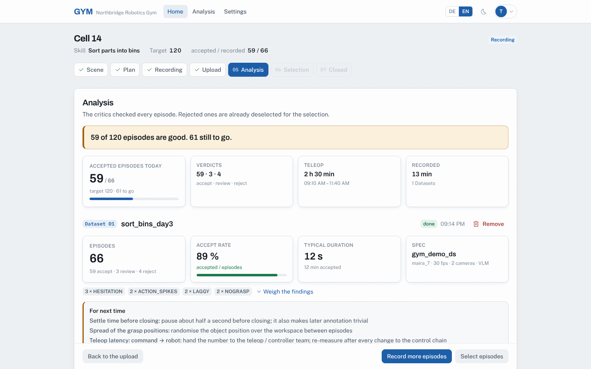
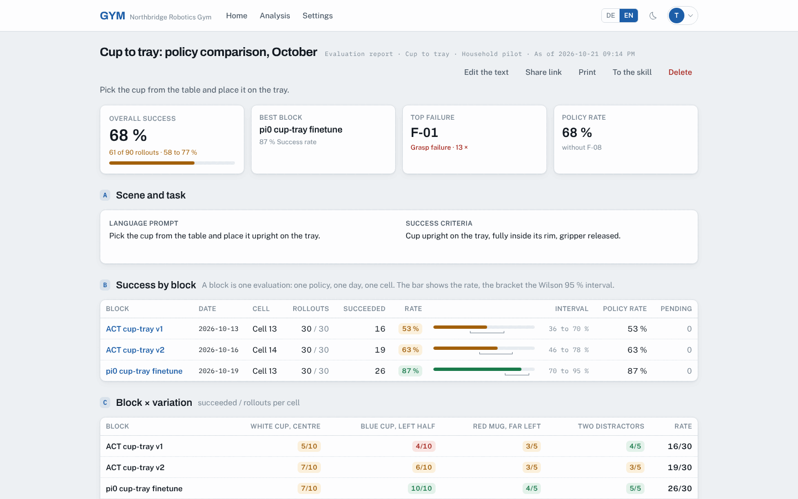
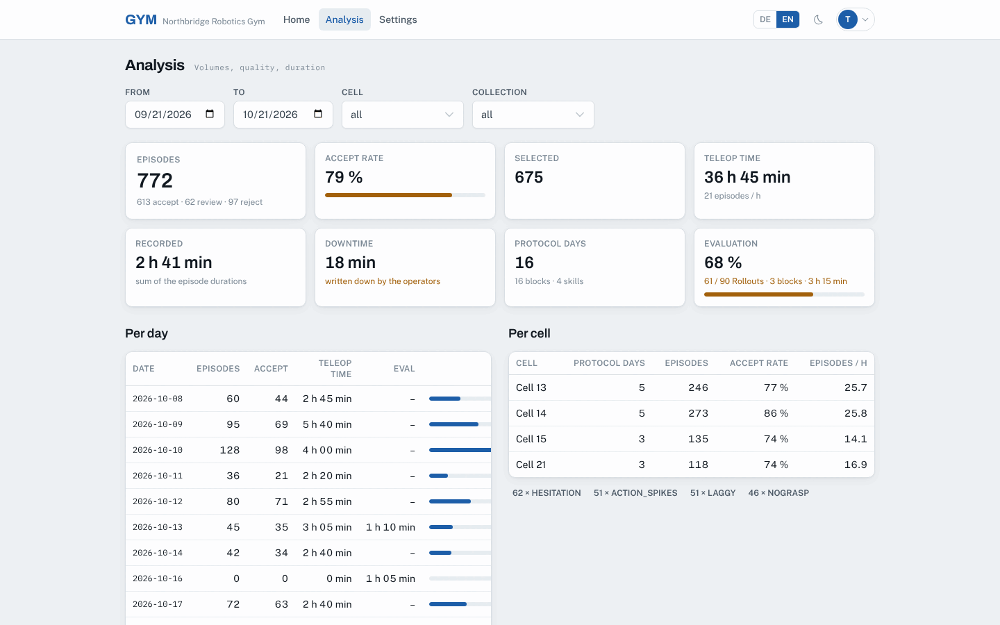

# GYM

**From teleoperation to a trained, evaluated robot policy, with a record of every step.**

GYM is the open-source web app for a robotics gym. It walks operators at the
training cells through each block of work (scene, AI plan, recording, upload,
analysis, episode selection, export), has every episode judged by the built-in
data critics, and turns policy evaluations into reports you can share. Analysts
get the figures, the day protocols and the audit log, in the browser or through MCP.



<table>
  <tr>
    <td></td>
    <td></td>
  </tr>
  <tr>
    <td align="center"><sub>Evaluation report: policies side by side, per variation, with intervals</sub></td>
    <td align="center"><sub>Analysis: volumes, quality and time across cells and skills</sub></td>
  </tr>
</table>

<sub>Screenshots show fictional demo data.</sub>

## Highlights

- **A step guide for the operator.** Every block runs as a stateful wizard:
  nothing is lost on a browser restart, and the day protocol of the cell is
  created on the fly.
- **Phone in the loop.** A QR code opens the phone view for the scene photo and
  a spoken or typed description; a second one opens the run view that counts
  episodes at the cell.
- **AI recording plans.** Gemini reads photo and text and proposes scene setups,
  domain randomizations and episode counts (or, for an evaluation, the settings
  to test). Without a model the plan falls back to a deterministic one, so the
  wizard never blocks.
- **Every episode judged.** Uploaded LeRobot datasets go to the data critics
  (`critics/`): hard critics on kinematics and video, soft critics with a
  vision-language model. Each episode gets accept, review or reject, with the
  flags that decided it and advice for the next session.
- **One merged dataset for training.** Select episodes across all days and cells
  of a skill and download them as one renumbered LeRobot dataset, plus a manifest
  with `--episodes` ranges.
- **Policy evaluation that holds up.** Evaluation blocks record rollouts, a person
  reviews them with failure codes, and success rates come with Wilson 95 %
  intervals. Evaluation reports compare blocks per variation and failure mode and
  can be shared as a public, printable link.
- **Key figures and accountability.** Episodes, accept rate, teleop time,
  episodes per hour and downtime per day, cell and skill; printable day
  protocols; an audit log per skill and day protocol.
- **Built for analysts and agents.** A read-only MCP server and an OpenAPI-documented
  REST API expose skills, blocks, datasets, reports and KPIs.
- **Self-hostable.** Docker images for app and critics, a Traefik stack with
  Let's Encrypt, Postgres or embedded PGlite for development, German and English
  UI, light and dark mode. Apache-2.0.

## Documentation

- [docs/PRODUCT.md](docs/PRODUCT.md): what the app is for, in one page
- [docs/GLOSSARY.md](docs/GLOSSARY.md): the binding vocabulary
- [design.md](design.md): design system, UX flow and figure definitions
- [AGENTS.md](AGENTS.md): rules for coding agents

Built on the [symbiosika-framework](https://github.com/symbiosika/symbiosika-framework)
(git submodule at `backend/framework`): users, organisations, magic-link login,
file storage, OAuth2 server for MCP clients, database layer. Dataset analysis is
done by the **data critics** in [`critics/`](critics/README.md), the Python
engine of this repository. It runs as the `critics` service of the compose
stack and the app reaches it over the internal network; the app itself never
judges data.

## The operator's day

Two things are kept apart. The **day protocol** is the cell's record of one
day: operator, downtime, notes, a printable view, and the **blocks** worked
that day. The **skill** is what is trained: task, critics spec, its recording
blocks over all days and cells, the episode selection, the exports and its
**policies**. A block is one stretch of work in a day for one skill, either a
recording block (teleoperation) or an evaluation block (a trained policy runs
and its rollouts are judged). A day may hold four recordings for one skill, or
a recording for skill A in the morning and an evaluation of skill B in the
afternoon.

1. **Home**: tiles "Start a block", "Continue a skill", "Analysis"; today's day
   protocols with their blocks to jump back in.
2. **Start**: pick the cell, the kind (recording or evaluation), the skill (an
   existing one or a new one) and, for an evaluation, the policy under test.
   Today's day protocol of the cell is created when it is missing; the new
   block takes over scene, target and plan of the skill's last block of the
   same kind. "Import from another skill" copies them from elsewhere.
3. **Scene**: a QR code opens the phone view. Photo first, then a description
   by voice or typing, done. The operator's screen picks it up live. Photo and
   text can be edited or replaced; the phone step can be skipped. The target
   number of episodes (rollouts for an evaluation) is set here; the kind can
   still be changed while the block is empty.
4. **Plan**: the AI (Gemini) reads photo and text and proposes scene setups
   with domain randomizations and episode counts; for an evaluation it
   proposes which settings to test the policy on, the recorded ones first, then
   unseen ones. Editable; an evaluation may also start without a plan.
   "Start recording" shows a second QR code: the run view at the cell lists the
   steps, "next" counts an episode. Every open and close of the recording step
   is one window, and their sum is the block's time (teleop time in a
   recording, evaluation time in an evaluation), so a block picked up again
   does not count the break in between. A standstill of the cell leaves no
   trace in the tool, so it is written down by hand on the day protocol: a
   reason and a number of minutes.
5. **Upload**: the LeRobot datasets of the recording, each as one zip (data,
   videos, meta); several can be dropped at once. GYM hands every zip to the
   **data critics**, which run the hard critics (kinematics, video) and the
   soft critics (a vision-language model) over every episode.
6. **Analysis**: the critics' verdicts (accept, review, reject), the flags that
   decided them, the recording-session profile with what to do, the visual
   report, and the AI's advice on what to record again. A run whose
   vision-language model did not answer is called out in red here and on the
   analysis page. "Record more episodes" loops back; every upload adds a
   dataset with its own critics run to the block. In an evaluation the accept
   rate of the rollouts is the policy's success rate, and the block is closed
   from here.
7. **Selection**: every episode of every recording dataset of the skill, over
   all its days and cells, in one table. Rejected episodes start deselected;
   the operator decides. Evaluation rollouts are never part of it. The primary
   download is the **merged dataset**: the selected episodes of every upload as
   one LeRobot dataset, renumbered without gaps, with one task table, ready to
   hand to training. Next to it the small download: the manifest (episode
   indexes per dataset, also as `--episodes` ranges) and the critics' selection
   files.
8. **Closed**: the block is done; the day protocol has a printable view with a
   shareable link that lists every block of the day.

The skill page shows where a skill stands: its blocks by day and cell, its
evaluations over time with the success rate per policy, its policies (trained
from which export, when), its episodes and exports. The wizard is stateful
(every input is saved), every action is in an audit log that is read per skill
and per day protocol, and analysts see everything in the analysis views or
through the MCP server.

## Setup (local, no Docker)

Requires [Bun](https://bun.sh) 1.2 or newer.

```bash
git clone --recurse-submodules https://github.com/symbiosika/gym.git
cd gym

# backend
cd backend
bun install
bun run init          # .env with secrets, POSTGRES_CONNECTION_POOL_SIZE=1 for PGlite
bun run db:local      # terminal 1: embedded PGlite database on localhost:5432
bun run migrate       # framework and app migrations
bun run dev           # terminal 2: API on http://localhost:3000

# frontend
cd ../frontend
bun install
bun run dev           # http://localhost:5173/static/app/  (proxied to the API)
```

Login without a mail server: `SMTP_HOST=console.localhost` (default) writes
the magic-link mails to `backend/logs/email/`. Test user with a JWT:
`cd backend && bun run testuser`. The first login creates an organisation.
Demo data (cells, a collection, a skill with a recording block on today's day protocol): `cd backend && bun run seed:demo`.

### Data critics (required for uploads)

The critics are the Python engine in [`critics/`](critics/README.md). They are
built from this repository ([`Dockerfile.critics-service`](Dockerfile.critics-service))
and run as their own container (x86_64 and arm64), because they need ffmpeg,
numpy and OpenCV:

```bash
docker compose -f docker-compose.critics.yml up -d --build   # http://localhost:8080, web UI at /ui
```

That is all: the API looks for them on `http://localhost:8080` and
`docker-compose.prod.yml` points it at `http://critics:8080`, so nothing has to
be configured. Datasets, results and specs land in `.critics-data/`.

The critics container itself needs **one** variable, and only to judge task
success; everything else has a working default baked into the image
(`/data`, `/jobs`, `/specs`, host `0.0.0.0`, port 8080):

| Variable | Where | Effect |
|---|---|---|
| `GEMINI_API_KEY` | critics | the vision-language model that judges task success. Without it a run is still complete, it just stops at the hard critics. |
| `OPENROUTER_API_KEY` | critics | alternative to Gemini: any OpenAI-compatible endpoint, selected per spec. |
| `CRITICS_API_KEY` | critics + app | set it to require `X-API-Key` on every route but `/health`. Leave empty on a trusted network. |
| `CRITICS_URL` | app | only to move the service elsewhere; the default is the compose service. |

To run the critics on their own, on a second machine or a Jetson, there is a
lightweight sample stack:

```bash
echo "GEMINI_API_KEY=..." > .env
docker compose -f docker-compose.critics-service.yml up -d --build
```

A skill picks a stored **spec** (what the critics check: task, objects,
thresholds, indicators) or leaves it to the auto spec the critics derive from
the dataset. Specs are created in the critics' web UI or with
`lerobot-critics init-spec`; GYM lists them per skill. Results are mirrored
into GYM once a minute and whenever a block is opened: report.json, selection.json,
one row per episode with verdict, score, flags and the reason it was filtered.
The rollouts of an evaluation block go through the same run; their accept rate
is the policy's success rate.

### AI

| Variable | Effect |
|---|---|
| `GEMINI_API_KEY` | Gemini proposes plans from photo and text and advises on follow-ups (`GEMINI_MODEL`, default `gemini-2.5-flash`). It also draws the optional reference image of a plan variation from the scene photo (`GEMINI_IMAGE_MODEL`, default `gemini-2.5-flash-image`). |
| `AI_PROVIDER` + key | Fallback: the framework's central provider (`mistral`, `openrouter`). |
| none | Deterministic plans without AI, no generated images; the wizard never blocks. Reference images can still be uploaded by hand. |

### Phone views

The QR codes link to `/static/app/#/m/capture/<token>` and `/m/run/<token>`.
The phone must reach the server, so set `BASE_URL` to the address the phones
use (the QR code uses the origin of the operator's browser). Voice input uses
the browser's speech recognition; the text is what counts.

## Setup with Docker (Postgres)

```bash
cd backend
bun run docker:up     # Postgres 17 + pgvector on 5432
# in .env: POSTGRES_CONNECTION_POOL_SIZE=10
bun run migrate && bun run dev
```

Full stack as containers:

```bash
git submodule update --init --recursive
cp backend/.env.prod.example backend/.env.prod   # fill in secrets (bun run init prints values)
docker compose -f docker-compose.prod.yml up --build -d   # app on http://localhost:3000
```

## Published images

Pushes to `develop` and `main` build both images in GitHub Actions
([`.github/workflows/build.yml`](.github/workflows/build.yml)) and push them to
the GitHub Container Registry of the repository owner:

```
ghcr.io/<owner>/gym           the app (SPA + API), root Dockerfile, target release-ci
ghcr.io/<owner>/gym-critics   the data critics, Dockerfile.critics-service
```

`main` is tagged `latest`, `develop` is tagged `develop`, and every build is
additionally tagged with its commit sha, so a deploy can be pinned exactly.
The app image is assembled from artifacts the workflow builds on the runner
(backend bundle, migrations, SPA); the `release-ci` stage only packages them.
The critics image builds straight from `Dockerfile.critics-service`.

Another registry is a matter of repository settings, not of edits: the
variables `IMAGE_REGISTRY` (the host to log in to) and `IMAGE_PREFIX` (host and
namespace the images are pushed under), and the secrets `REGISTRY_USER` and
`REGISTRY_TOKEN`. The optional deploy trigger after a successful push calls a
[Coolify](https://coolify.io) webhook when `COOLIFY_BASE_URL`,
`COOLIFY_DEPLOY_TOKEN`, `COOLIFY_UUID_PROD` and `COOLIFY_UUID_STAGING` are set;
a missing secret skips it with a log line instead of failing the build.

Running the images needs no checkout. [`deploy/docker-compose.yml`](deploy/docker-compose.yml)
puts the stack behind Traefik: it terminates TLS for `APP_DOMAIN`
(Let's Encrypt, HTTP challenge) and redirects port 80 to 443. Traefik is the
only service with published ports. The app is reachable through its route
only, and Postgres and the critics sit on an internal network with no route at
all. The critics' spec UI is bound to the host's loopback, so it is reachable
through an SSH tunnel and from nowhere else:

```bash
cp deploy/.env.example deploy/.env    # fill in APP_DOMAIN, ACME_EMAIL and the secrets
docker compose -f deploy/docker-compose.yml --env-file deploy/.env up -d

ssh -L 8080:127.0.0.1:8080 <host>     # then http://localhost:8080/ui
```

The domain has to resolve to the host before the first start, otherwise
Let's Encrypt cannot issue the certificate.

## Tests

```bash
cd backend && bun run test:local     # all backend tests against an embedded PGlite
cd backend && bun run typecheck
cd frontend && bun run test          # Vitest
cd frontend && bun run type-check
cd critics && pytest -q             # the data critics (needs ffmpeg)
```

## MCP for analysts

`/mcp` on the domain root (framework feature). In claude.ai: connectors,
custom connector, URL `https://<host>/mcp`, sign in with the gym account,
pick the organisation. Read-only tools: `whoami`, `list_cells`,
`list_collections`, `list_skills`, `get_skill`, `get_skill_audit`,
`list_day_protocols`, `get_day_protocol`, `get_day_protocol_audit`,
`list_blocks`, `get_block`, `get_dataset`, `get_dataset_report`,
`get_dataset_markdown`, `get_skill_selection`, `get_kpis`. Scripts use an API token (`X-API-KEY`).
OpenAPI docs at `/api/v1/docs`.

## Layout

```
backend/   Bun + Hono API, framework submodule, gym_ tables, critics client, AI, MCP
frontend/  Vue 3 SPA, Tailwind v4 + PrimeVue Volt, dark mode, DE/EN
critics/   the data critics: Python analysis engine, CLI and REST service
docs/      PRODUCT.md, GLOSSARY.md
design.md  design system, UX flow, figure definitions
AGENTS.md  rules for coding agents

Dockerfile                          the app (SPA + API) as one image
Dockerfile.critics-service          the data critics as one image
docker-compose.critics.yml          dev: the critics next to `bun run dev`
docker-compose.critics-service.yml  the critics on their own, one variable
docker-compose.prod.yml             the full stack from source: Postgres, critics, app
deploy/docker-compose.yml           the full stack from the published images, behind Traefik
.github/workflows/build.yml         builds and pushes both images, optional deploy trigger
```

The API is described in [backend/README.md](backend/README.md).

## Contributing

Contributions are welcome. Read [CONTRIBUTING.md](CONTRIBUTING.md) first; it
explains the setup, the checks a change has to pass and the vocabulary the code
keeps to. Security issues go privately to the address in
[SECURITY.md](SECURITY.md), not into a public issue. Everyone taking part
follows the [Code of Conduct](CODE_OF_CONDUCT.md).

## License

GYM is licensed under the [Apache License 2.0](LICENSE), including the data
critics in `critics/`. Copyright 2026 Symbiosika GmbH. The
[symbiosika-framework](https://github.com/symbiosika/symbiosika-framework) in
`backend/framework` is a separate project under its own license.
